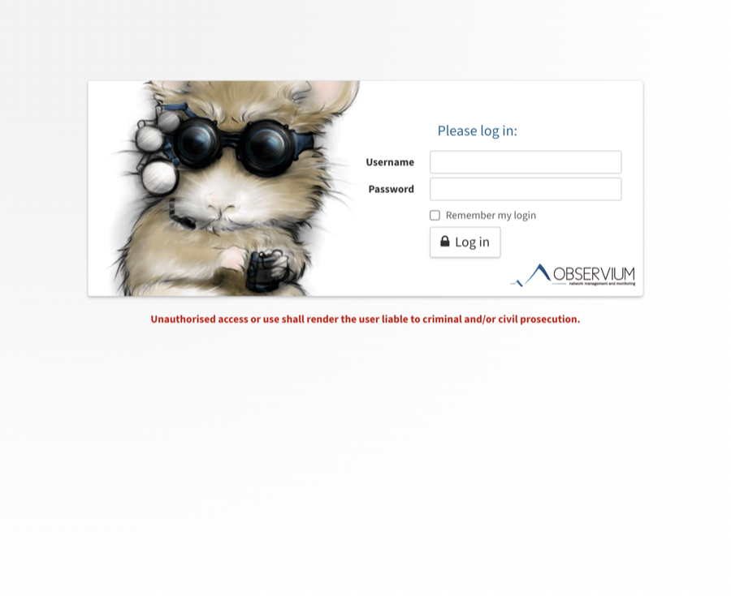
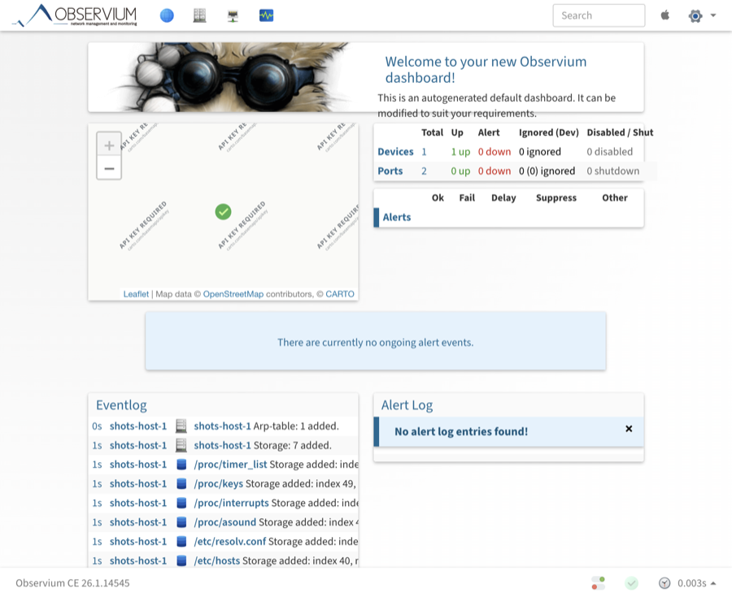
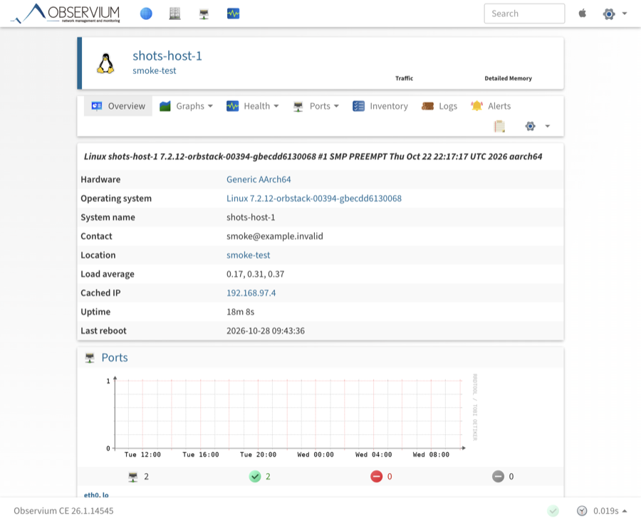

# Observium Docker (Debian 13)

[](https://hub.docker.com/r/tuantuantuantuantuan/observium)
[](#)
[](#)
[](#)
[](LICENSE)

Weekly workflow automation keeps Docker Hub up to date with both `:latest` and stable version tags like `:25.4.0`.

Unofficial Docker image for **Observium Community Edition** with a simple local stack:
- `observium` container: Nginx + PHP 8.5-FPM
- `db` container: MariaDB 11
- persistent data via local bind mounts

## Screenshots

| Login | Autogenerated dashboard |
|---|---|
| [](docs/images/login.png) | [](docs/images/dashboard.png) |

[](docs/images/device.png)

Captured from a local build of this repository, with a test device added through
the SNMP agent in `scripts/snmpd/`. The dashboard is the one
`docker/entrypoint.sh` seeds on first start; its map widget needs a map tile
provider key before it draws tiles.

## Quick Links

- Docker Hub: [tuantuantuantuantuan/observium](https://hub.docker.com/r/tuantuantuantuantuan/observium)
- Image tag used by default in `compose.yaml`: `tuantuantuantuantuan/observium:latest`
- Stable version tags are also available: `tuantuantuantuantuan/observium:{version}`

## Documentation

| Document | Covers |
|---|---|
| [`docs/README.md`](docs/README.md) | index of all guides |
| [`docs/ARCHITECTURE.md`](docs/ARCHITECTURE.md) | containers, boot sequence, volumes, build and release pipeline, trust boundaries |
| [`docs/BACKUP_RESTORE.md`](docs/BACKUP_RESTORE.md) | what is stateful, database dumps, `./data` archives, restoring and verifying |
| [`docs/UPGRADE_ROLLBACK.md`](docs/UPGRADE_ROLLBACK.md) | what an upgrade runs, and how to go back after a schema migration |
| [`docs/TESTING.md`](docs/TESTING.md) | the Compose smoke test and the CI workflows |
| [`docs/PINNING.md`](docs/PINNING.md) | pinning a deployment to a tag or a digest |
| [`docs/SECURITY_HARDENING.md`](docs/SECURITY_HARDENING.md) | credentials, exposure, TLS, host hardening |
| [`SECURITY.md`](SECURITY.md) | reporting a vulnerability |
| [`CONTRIBUTING.md`](CONTRIBUTING.md) | branch, commit and pull request conventions |
| [`CODE_OF_CONDUCT.md`](CODE_OF_CONDUCT.md) | community expectations |
| [`LICENSE`](LICENSE) | licensing of this packaging, and of Observium itself |

## Quick Start

### 1. Start with Docker Compose

```bash
git clone https://github.com/tdtgit/observium.git
cd observium
docker compose up -d
```

Open:
- `http://localhost:8080`

Login as `admin`. The password is generated on the first start and printed
**once**, in the container log:

```bash
docker compose logs observium | grep -A8 "INITIAL ADMINISTRATOR"
```

To pick the password yourself, set `OBSERVIUM_ADMIN_PASSWORD` in `.env` before
the first `docker compose up -d`; the entrypoint then uses it and prints no
banner. Earlier versions of this stack defaulted to `admin`/`admin`; if you
still run one of those, change the password (or recreate the container with
`OBSERVIUM_ADMIN_PASSWORD` set). See
[`docs/SECURITY_HARDENING.md`](docs/SECURITY_HARDENING.md).

To publish the web UI on a different host port, set `OBSERVIUM_HTTP_PORT` (for
example in `.env`) and run `docker compose up -d` again.

### 2. Data Persistence

This project uses bind mounts (host folders):
- `./data/db` -> MariaDB data
- `./data/rrd` -> Observium RRD data
- `./data/logs` -> Observium logs

## Architecture

```
compose.yaml
  observium   nginx :80 -> host ${OBSERVIUM_HTTP_PORT:-8080}, PHP 8.5-FPM, cron
              ./data/rrd  -> /opt/observium/rrd
              ./data/logs -> /opt/observium/logs
  db          mariadb:11, no published ports
              ./data/db   -> /var/lib/mysql
              observium only starts once db passes its healthcheck
```

`docker/entrypoint.sh` runs on every start of the `observium` container (when
the command is nginx in the foreground): it writes `config.php` from the
environment, initialises or repairs the schema, creates the initial admin,
seeds the default dashboard, then starts PHP-FPM and cron. Nothing under
`/opt/observium` outside `rrd/` and `logs/` survives a container recreation —
`config.php` included.

Boot order, volume ownership, the three build stages, the release workflows
and the trust boundaries are documented in
[`docs/ARCHITECTURE.md`](docs/ARCHITECTURE.md).

## Common Operations

### Update to the latest image

```bash
docker compose pull
docker compose up -d
```

### Stop services

```bash
docker compose down
```

### Reset all local data

```bash
docker compose down
rm -rf ./data/db ./data/rrd ./data/logs
mkdir -p ./data/db ./data/rrd ./data/logs
```

### Repair a broken database schema

Symptom: adding the first device works, every further device fails with
`Duplicate entry '0' for key 'PRIMARY'`, and the container log shows
`Install initial database schema ... FALSE.`

Cause: the initial schema import (`update/db_schema_mysql.sql`) was aborted
before `devices.device_id` received `AUTO_INCREMENT`, so every device is
stored with the primary key `0`.

The entrypoint repairs `devices.device_id` on startup and logs what it did.
If the repair fails (or the log also reports unreachable tables), recreate the
database and add your devices again. A recreated data directory is created
with `lower_case_table_names=1`, so the schema import completes:

```bash
docker compose down
rm -rf ./data/db
docker compose up -d
```

## Database notes

### `lower_case_table_names`

Observium's schema uses mixed case table names (`bgpPeers`, `entPhysical`,
`hrDevice`, ...). With `lower_case_table_names=2` (the MariaDB default on case
insensitive filesystems, e.g. macOS bind mounts) an `ALTER TABLE` on such a
table leaves it unreachable by name, the schema import stops at the first
error, and the schema ends up incomplete.

The mode can only be chosen while the data directory is created, so
`docker/db-entrypoint.sh` (used by the `db` service) decides it:

- **new data directory** -> `lower_case_table_names=1`, table names are stored
  lower case and every lookup finds them again, so the schema import
  completes
- **existing data directory** -> the mode it was created with is kept, so
  upgrading never changes how the stored table names are looked up

The chosen mode is stored inside the data directory
(`./data/db/.observium-lower-case-table-names`) and survives a container
recreation.

The mode can be forced with `OBSERVIUM_DB_LOWER_CASE_TABLE_NAMES` (for example
in `.env`). That is only useful for an existing data directory, and the
entrypoint warns when the value differs from the mode the data directory was
created with, because the stored table names keep their own mode.

The `db` service runs `docker/db-entrypoint.sh` from this repository, so the
repository directory has to be next to `compose.yaml`.

Both files the script writes belong to it: the mode file inside
`./data/db` and `/etc/mysql/conf.d/zz-observium.cnf` inside the `db`
container. The container file is regenerated on every start and removed when
the data directory has to keep its own mode; no other configuration file is
touched. Deleting either file is safe - the next start recreates or removes it
as needed. Deleting the mode file does not change the data directory, it only
makes the next start fall back to the server default (or to the forced value).

A database that was imported with `lower_case_table_names=2` cannot be fixed
in place: the affected tables are already unreachable. Recreate the data
directory, it is then created with `lower_case_table_names=1`.

If you run your own database, create it with `lower_case_table_names=1`.

### Open a database console

The database runs in its own container, so the local socket path
(`/run/mysqld/mysqld.sock`) does not exist inside the `observium` container.
Connect over the network instead:

```bash
# from the host
docker compose exec db mariadb -uobservium -pobservium observium

# from the observium container
docker compose exec observium mariadb -h db -uobservium -pobservium observium
```

## Configuration

Prefer editing env vars in `compose.yaml` (and optional `.env` values consumed by Compose), instead of injecting env vars directly into commands.

Example in `compose.yaml` (`services.observium.environment`):

```yaml
services:
  observium:
    environment:
      OBSERVIUM_ADMIN_USER: ${OBSERVIUM_ADMIN_USER:-netops}
      OBSERVIUM_ADMIN_PASSWORD: ${OBSERVIUM_ADMIN_PASSWORD:?set a strong admin password}
      OBSERVIUM_ENABLE_RAMDISK: ${OBSERVIUM_ENABLE_RAMDISK:-true}
      OBSERVIUM_SHM_SIZE: ${OBSERVIUM_SHM_SIZE:-8g}
      OBSERVIUM_RAMDISK_SYNC_INTERVAL: ${OBSERVIUM_RAMDISK_SYNC_INTERVAL:-300}
```

`OBSERVIUM_ADMIN_PASSWORD` has no fallback in `compose.yaml` on purpose: when
it is unset the entrypoint generates a password and prints it once. The `:?`
above is for the case where you want a copied example to fail loudly instead
of starting with a placeholder password.

Apply changes:

```bash
docker compose up -d
```

## Customize Cron and Nginx

If you want to keep using the public image but provide your own scheduler or web config, add a `compose.override.yaml` file.

Example `compose.override.yaml`:

```yaml
services:
  observium:
    volumes:
      - ./custom/observium.cron:/etc/cron.d/observium:ro
      - ./custom/observium.nginx.conf:/etc/nginx/conf.d/observium.conf:ro
```

Then restart:

```bash
docker compose up -d
```

Notes:
- Cron file format should follow `/etc/cron.d` style (include user field, usually `www-data`).
- Keep your nginx config listening on port `80` inside the container.

## Important Environment Variables

### Observium app
| Variable | Default | Notes |
|---|---|---|
| `OBSERVIUM_DB_HOST` | `db` | Database host |
| `OBSERVIUM_DB_NAME` | `observium` | Database name |
| `OBSERVIUM_DB_USER` | `observium` | Database user |
| `OBSERVIUM_DB_PASSWORD` | `observium` | Database password |
| `OBSERVIUM_CREATE_ADMIN` | `true` (compose) | Create initial admin user |
| `OBSERVIUM_ADMIN_USER` | `admin` | Initial admin username |
| `OBSERVIUM_ADMIN_PASSWORD` | empty (generated, printed once) | Initial admin password; empty means the entrypoint generates one |
| `OBSERVIUM_ADMIN_LEVEL` | `10` | Admin privilege level |
| `OBSERVIUM_INIT_DB_SCHEMA` | `true` (compose) | Initialize/update DB schema on startup |
| `OBSERVIUM_ENABLE_CRON` | `true` | Enable poller/discovery cron |

### Performance tuning
| Variable | Default | Notes |
|---|---|---|
| `OBSERVIUM_ENABLE_FASTCACHE` | `true` | Enable Observium fast cache |
| `OBSERVIUM_CACHE_DRIVER` | `apcu` | Cache backend |
| `OBSERVIUM_PHP_MEMORY_LIMIT` | `512M` | PHP memory limit |
| `OBSERVIUM_APCU_SHM_SIZE` | `128M` | APCu shared memory size |

### RAM-disk RRD mode (optional)
| Variable | Default | Notes |
|---|---|---|
| `OBSERVIUM_ENABLE_RAMDISK` | `false` | Enable RRD writes to RAM disk |
| `OBSERVIUM_RAMDISK_PATH` | `/dev/shm/observium-rrd` | In-container RAM-disk path |
| `OBSERVIUM_RAMDISK_SYNC_INTERVAL` | `300` | Seconds between RAM -> persistent sync |
| `OBSERVIUM_SHM_SIZE` | `256m` (compose) | Container shared memory size |

### MariaDB image and binary log (compose)
| Variable | Default | Notes |
|---|---|---|
| `MARIADB_IMAGE` | `mariadb:11` | Database image; pin it (tag or digest) for a reproducible deployment, see [`docs/PINNING.md`](docs/PINNING.md) |
| `MARIADB_BINLOG_OPTION` | `--skip-log-bin` | Set to `--log-bin` to enable binary log |

## Verify Runtime Status

### Container health

```bash
docker compose ps
```

### Check PHP memory/cache from UI
In Observium web UI footer you should see similar to:
- `FastCache: Yes`
- `OPcache: Yes`
- `Memory: 512MB`

### Verify RAM-disk RRD path

```bash
docker compose exec -T observium grep "rrd_dir" /opt/observium/config.php
```

Expected when enabled:
- `$config['rrd_dir'] = '/dev/shm/observium-rrd';`

### Check the PHP version

Each architecture may be on a different PHP patch release for a short window after an upstream release (the PHP repository publishes architectures independently), so check the version you actually run.

One-shot, without starting the stack:

```bash
docker run --rm --entrypoint php tuantuantuantuantuan/observium:latest -v
```

Exact package version, including the repository build suffix:

```bash
docker run --rm --entrypoint sh tuantuantuantuantuan/observium:latest -c \
  'dpkg-query -W php8.5-cli php8.5-fpm php8.5-apcu'
```

The build also records the resolved version in a file:

```bash
docker run --rm --entrypoint cat tuantuantuantuantuan/observium:latest /etc/php-version
```

Running container:

```bash
docker compose exec observium php -v
docker exec <container> php-fpm8.5 -v
```

To see which architecture your host pulled, and compare both:

```bash
for p in linux/amd64 linux/arm64 linux/arm/v7; do
  printf '%-14s ' "$p"
  docker run --rm --platform "$p" --entrypoint php \
    tuantuantuantuantuan/observium:latest -r 'echo PHP_VERSION, PHP_EOL;'
done
```

### Check installed component versions

The image also records the versions of the main components it ships, plus the
Observium release it contains:

```bash
docker run --rm --entrypoint cat tuantuantuantuantuan/observium:latest /etc/observium-components
docker inspect -f '{{index .Config.Labels "org.observium.version"}}' \
  tuantuantuantuantuan/observium@sha256:<digest>
```

Running container:

```bash
docker compose exec observium cat /etc/observium-components
```

`org.observium.version` and the `observium` line in `/etc/observium-components`
are set by the release workflow from the tarball it downloaded, so a pinned
digest traces back to a release. Local and pull request builds are deliberately
unstamped: an empty label means "not a release", not "unknown release".

## Release Automation

Five workflows build, validate, publish, scan and drill the image.

| Workflow | Trigger | Purpose |
|---|---|---|
| `upstream-release.yml` | weekly schedule, or manual dispatch | Resolves the upstream Observium version, builds `linux/amd64`, `linux/arm64`, and `linux/arm/v7`, pushes them by digest, boots the `linux/amd64` image with Compose as a smoke test, and only then creates the Docker tags plus the GitHub release |
| `php-refresh.yml` | daily schedule, or manual dispatch | Compares the PHP version published in the image against the versions currently offered by the PHP repository, and triggers a release rebuild when they differ |
| `pull-request.yml` | pull requests | Runs the static checks, then builds the pull request image and runs the same Compose smoke test against it |
| `image-scan.yml` | weekly schedule, manual dispatch, pull requests | Scans the published image with Trivy and reports; pull request builds fail only on fixable `CRITICAL` findings |
| `restore-drill.yml` | nightly schedule, manual dispatch | Builds the default branch and runs `scripts/restore-drill.sh`: two throwaway stacks, a documented dump and RRD archive in between, then assertions on schema, admin user, dashboards, device IDs, RRD files and login |

### Smoke test before publishing

Between the build and the tag push, `upstream-release.yml` runs
[`scripts/smoke-compose.sh`](scripts/smoke-compose.sh) against the exact
`linux/amd64` image digest it is about to tag. The script boots the stack in a
throwaway directory (empty database, no `./data` involved) and fails the release
when any of these is not true:

- both containers reach a healthy state and the web UI answers `HTTP 200`;
- the `observium` container did not restart while starting, and the entrypoint
  log contains no `ERROR`;
- the schema import completed (`lower_case_table_names=1`,
  `devices.device_id` is `AUTO_INCREMENT`, admin user and default dashboard
  exist);
- logging in with the configured admin credentials renders the dashboard;
- two devices are added with the real `add_device.php` against test SNMP
  agents (`scripts/snmpd/`, run as sidecars that are never published), get
  distinct non-zero `device_id`s, and are removed again with
  `delete_device.php` (including their RRD directories);
- a second start of the entrypoint is idempotent: no duplicate-key failure, no
  duplicate admin, dashboard, or widget rows, and the deleted devices stay
  deleted.

A failed smoke test stops the release, so no Docker tag and no GitHub release is
created for an image that does not start. The arm64 and armv7 images are not run
as a full stack: booting MariaDB, nginx and the poller under QEMU is slow enough
to dominate the run, and it would prove nothing that the amd64 boot does not
already prove. They are executed instead —
[`scripts/test-image-arch.sh`](scripts/test-image-arch.sh) pulls the digest for
the platform and checks that PHP runs there and reports the version in the
`org.observium.php.version` label, that `PHP_INT_SIZE` is `8` on `arm64` and
`4` on `arm/v7`, that `php-fpm8.5` and the entrypoint are present, and that
`nginx -t` passes. Everything above the image — the Compose wiring, the
entrypoint logic, the schema and the login — is architecture independent, so
the amd64 smoke test covers it. The full matrix, and why only the execution test
runs under QEMU, is in [`docs/TESTING.md`](docs/TESTING.md#architecture-execution).

### Pull request checks

`pull-request.yml` runs the same smoke test for every pull request, building the
image from the pull request instead of pulling a digest. Before that it runs
[`scripts/check-static.sh`](scripts/check-static.sh): `bash -n` on the shell
scripts, ShellCheck, actionlint, a YAML parse of the workflows and
`docker compose config -q`. Run it locally before opening a pull request — it
needs no image build.

Contributor code is untrusted, so the workflow is deliberately constrained:

- it runs on `pull_request`, **never** `pull_request_target`, so pull requests
  from forks receive a read-only `GITHUB_TOKEN` and no repository secrets;
- `permissions: contents: read`, and checkout credentials are disabled so the
  token does not end up in `.git/config` where build scripts could read it;
- nothing is pushed to a registry and no secrets are referenced, so a
  contributor cannot publish an image or read credentials;
- it only ever runs on GitHub-hosted ephemeral runners. Building a
  contributor's Dockerfile and booting their `compose.yaml` is arbitrary code
  execution on the runner, even though no secrets are reachable. Never route
  this workflow to a self-hosted runner;
- `concurrency` cancels superseded runs and `timeout-minutes` bounds a run.

GitHub additionally requires a maintainer to approve the first workflow run from
a new contributor, which is the default for public repositories.

### Tags and releases

Releases are identified by **build date**, not by the upstream Observium version, so every publication shows up as new activity even when the Observium version itself has not changed. A second build on the same day gets a numeric suffix (`2026.10.22-2`).

| Docker tag | Meaning |
|---|---|
| `:{date}` | immutable, one per build — use this to pin |
| `:{version}` | current Observium version, moves when the image is rebuilt |
| `:latest` | rolling |

A release is created when the Observium version is new, or when a rebuild is triggered because the PHP version changed. Nothing is published when neither has changed.

### Release token

Creating a release also creates its git tag. GitHub will not let a workflow create a tag that points at a commit changing `.github/workflows/`, because the built-in token cannot carry the `workflows` scope. Add a fine-grained personal access token with **contents: write** and **workflows: write** as the `RELEASE_TOKEN` secret to cover that case:

- with the secret, releases work from any commit;
- without it, releases still work, except for a commit that modifies workflow files (the job fails with an explicit message).


### Platform support

| Platform | Debian architecture | Notes |
|---|---|---|
| `linux/amd64` | `amd64` | 64-bit x86 |
| `linux/arm64` | `arm64` | 64-bit ARM; preferred on ARM hardware |
| `linux/arm/v7` | `armhf` | 32-bit ARM (Raspberry Pi 2/3 and other ARMv7 boards running a 32-bit OS) |

Those are the architectures listed in the signed `trixie` `Release` of the [sury](https://packages.sury.org/php) PHP repository. Debian 13 also builds `i386`, `armel`, `ppc64el`, `riscv64`, and `s390x`, but the repository has no installable `php8.5-cli` for them (the `i386` index is frozen at PHP 8.5.0 and is not part of the signed `Release`), so this stack cannot build for those platforms. ARMv6 boards (`armel`, e.g. Raspberry Pi 1 and Zero) are therefore not supported.

`linux/arm/v7` is a 32-bit userland, so PHP integers are 32-bit there, unlike the other two platforms (for example, timestamps stop fitting in a PHP integer in 2038). Use `linux/arm64` where the hardware supports it.

### PHP version per architecture

The image installs PHP from the [sury](https://packages.sury.org/php) repository, which publishes each architecture independently. A newly released PHP patch therefore reaches `amd64` before `arm64` and `armhf`, and during that window the multi-arch tag is intentionally not version-identical across architectures: each architecture gets the newest release available for it.

Each build records the version it resolved:

```bash
docker run --rm --entrypoint sh tuantuantuantuantuan/observium:latest -c \
  'dpkg-query -W -f="\${binary:Package} \${Version}\n" "php8.5-*"'
```

The same value is stored in the image label `org.observium.php.version`, which is what `php-refresh.yml` compares against the repository. Once the slower architecture catches up, the daily check detects the difference and rebuilds, so the tags converge automatically.

### Release note contents

Each GitHub release is generated from the published image, and always contains:

- the image tags, the multi-arch manifest digest, and each platform's image digest and compressed size,
- a table of installed component versions per architecture — Debian, Nginx, PHP, MariaDB client, RRDtool, Net-SNMP, and the bundled diagnostic utilities,
- the commands to inspect the installed versions in a deployment.

The component versions are read back from the published image itself
(`/etc/observium-components`, with `/etc/php-version` still verified for PHP),
so the note always describes the bytes that users pull.

### Overriding the release note

When a release is not the usual automated one — for example an image rebuilt
because the PHP repository published a new patch release for one architecture
only — the prose part of the note can be overridden. A reason is mandatory and
is rendered in the release, so the deviation is always explained. See
[`release-notes/README.md`](release-notes/README.md).

```bash
gh workflow run upstream-release.yml --ref main \
  -f release_notes="This image was rebuilt to pick up the arm64 PHP build." \
  -f release_notes_reason="Republished to pick up the arm64 build of PHP 8.5.12."
```

### Verify the database schema

```bash
docker compose exec -T db mariadb -uobservium -pobservium observium \
  -e "SHOW CREATE TABLE devices\G" | grep device_id
```

Expected:
- `` `device_id` int(11) NOT NULL AUTO_INCREMENT ``

Without `AUTO_INCREMENT` only one device can be stored, every further device
fails with `Duplicate entry '0' for key 'PRIMARY'`.

## Build Locally (optional)

The provided compose file is for using the published image.

Build local image:

```bash
docker build -t observium:debian13 .
```

Run compose with local image:

```bash
OBSERVIUM_IMAGE=observium:debian13 docker compose up -d
```

### Validate an image before publishing

`scripts/smoke-compose.sh` boots the stack against any image reference and
checks startup, login, schema, and restart idempotency. It runs in a temporary
directory, so it always starts from an empty database and does not touch
`./data`:

```bash
docker build -t observium:debian13 .
scripts/smoke-compose.sh observium:debian13
```

It can also test an already published image, which is exactly what the weekly
release does with the digest it built:

```bash
scripts/smoke-compose.sh tuantuantuantuantuan/observium:latest
```

Pass `--keep` to keep the temporary stack directory for inspection. The script
picks a free host port unless `SMOKE_HTTP_PORT` is set, and logs in with
`admin`/`admin` unless `SMOKE_ADMIN_USER`/`SMOKE_ADMIN_PASSWORD` are set.

### Static checks without Docker

[`scripts/check-static.sh`](scripts/check-static.sh) never builds an image. It
runs `bash -n` over every shell script, ShellCheck (when installed), actionlint
at a pinned version, a YAML parse of every workflow, and
`docker compose config -q`:

```bash
scripts/check-static.sh
```

It is the first job of `pull-request.yml`, so a pull request fails on a syntax
error before an image is built.

### Execute an image for another architecture

An image can build successfully and still contain a PHP binary that will not
execute on the target platform. [`scripts/test-image-arch.sh`](scripts/test-image-arch.sh)
checks the image itself: PHP runs and reports the version in the
`org.observium.php.version` label, `PHP_INT_SIZE` matches the platform,
`php-fpm8.5` and the entrypoint exist, and `nginx -t` passes. The release runs
it for `linux/arm64` and `linux/arm/v7` before publishing:

```bash
docker pull --platform linux/arm64 tuantuantuantuantuan/observium:latest
scripts/test-image-arch.sh tuantuantuantuantuan/observium:latest linux/arm64
```

## License and attribution

This repository is **Docker packaging only**, and the packaging is MIT
licensed — see [`LICENSE`](LICENSE). It covers the `Dockerfile`, `compose.yaml`,
`docker/`, `scripts/`, `.github/` and the documentation.

Observium itself is **not** covered by that license. The image unpacks the
official Observium Community Edition tarball unmodified, and Observium is
licensed by its authors under the **"Observium License Version 1.0"**
(copyright Adam Armstrong, 2007-2013; Observium Limited, 2013-2021). The full
text ships inside the image and travels with it:

```bash
docker run --rm --entrypoint cat tuantuantuantuantuan/observium:latest \
  /opt/observium/LICENSE.COMMUNITY
```

This project is unofficial and is not affiliated with, endorsed by, or
sponsored by the Observium project. [`LICENSE`](LICENSE) states exactly what
this repository does and does not claim, including the third-party components
in the image (Debian, nginx, PHP, MariaDB, RRDtool and the rest).
