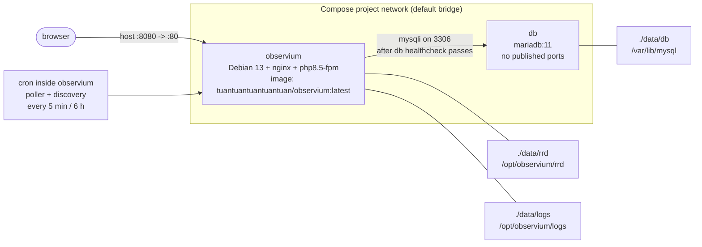

# Architecture

How this repository is put together: what runs in which container, what the
entrypoints do on boot, where state lives, how the image is built, how it is
released, and where the trust boundaries are.

Everything below is derived from the files in this repository
([`Dockerfile`](../Dockerfile), [`compose.yaml`](../compose.yaml),
[`docker/`](../docker/), [`.github/workflows/`](../.github/workflows/),
[`scripts/`](../scripts/)). When this document and a file disagree, the file
wins — please open an issue or a pull request if you find a stale sentence.

For day-to-day operation see the [README](../README.md); for backups,
upgrades, pinning and hardening see the [documentation index](README.md).

## Topology

Two containers on one Compose network, both with `restart: unless-stopped`:



```
+-----------------------------+          +-----------------------------+
| observium (Debian 13)       |          | db (mariadb:11)             |
|  nginx :80  -> :8080 host   |  MySQL   |  mariadbd :3306 (internal)  |
|  php-fpm8.5 unix socket     |--------->|  datadir /var/lib/mysql     |
|  cron: poller/discovery     |          |  healthcheck: mariadb-admin |
|  /opt/observium             |          +--------------+--------------+
|    rrd/    <- ./data/rrd    |                         |
|    logs/   <- ./data/logs   |                         |
+-----------------------------+                         |
                                         ./data/db -----+
```

| Service | Image | Published | Depends on | Healthcheck |
|---|---|---|---|---|
| `db` | `mariadb:11` | nothing | — | `mariadb-admin ping -h 127.0.0.1 -uroot -pobservium-root`, every 10 s, 10 retries |
| `observium` | `${OBSERVIUM_IMAGE:-tuantuantuantuantuan/observium}` (effectively `:latest`) | `${OBSERVIUM_HTTP_PORT:-8080}` → container port `80` | `db` with `condition: service_healthy` | from the image: `curl -fsS http://127.0.0.1/`, every 30 s, 60 s start period, 5 retries |

Consequences worth knowing:

- the `observium` container is not started until the `db` healthcheck passes,
  so a database that never becomes healthy looks like "the web UI never came
  up" rather than a database error;
- the database is never reachable from the host: no `ports:` entry on `db`,
  only the Compose network (`docker compose exec db ...` to get in);
- `shm_size` defaults to `${OBSERVIUM_SHM_SIZE:-256m}`, which is what the
  RAM-disk RRD mode needs (`/dev/shm` inside the container).

## Boot sequence: `docker/entrypoint.sh`

The image entrypoint is `tini -- /usr/local/bin/entrypoint.sh` and the default
command is `nginx -g "daemon off;"`
([`Dockerfile`](../Dockerfile)). The script only performs its setup when the
command is exactly that foreground nginx invocation:

```bash
is_nginx_foreground() {
  [[ "${1:-}" == "nginx" && "${2:-}" == "-g" && "${3:-}" == "daemon off;" ]]
}
```

So `docker run --entrypoint sh ...`, `docker run ... php -v` and
`docker compose exec` do not re-run the boot logic — and neither do they
reconfigure anything. With any other command the script simply `exec`s it.

With the default command, the order is:

1. **`configure_php_runtime`** — writes
   `/etc/php/8.5/fpm/conf.d/99-observium-tuning.ini` (and a copy under
   `/etc/php/8.5/cli/conf.d/`) with `memory_limit` from
   `OBSERVIUM_PHP_MEMORY_LIMIT`, OPcache enabled with
   `opcache.file_cache=/tmp/php-opcache`, `apc.enable_cli=1` and
   `apc.shm_size` from `OBSERVIUM_APCU_SHM_SIZE`.

2. **`setup_rrd_ramdisk`** — only when `OBSERVIUM_ENABLE_RAMDISK=true`. It
   refuses a path that equals the persistent RRD directory, creates
   `OBSERVIUM_RAMDISK_PATH`, and warms it from `/opt/observium/rrd` with
   `rsync -a --delete`. From then on `config.php` points `rrd_dir` at the RAM
   disk; the persistent copy is only updated by the sync loop in step 10.

3. **`prepare_config`** — creates `/opt/observium/config.php` from
   `config.php.default` if it does not exist, deletes the previous
   `// BEGIN Docker Managed Settings` … `// END Docker Managed Settings`
   block, and appends a fresh one containing:

   - `db_extension`, `db_host`, `db_user`, `db_pass`, `db_name`;
   - `install_dir`, `rrd_dir` (RAM-disk path when enabled), `log_dir`;
   - a computed `base_url` from `$_SERVER['HTTP_HOST']`, with `https` detected
     from `$_SERVER['HTTPS']` or `HTTP_X_FORWARDED_PROTO`, so a TLS-terminating
     reverse proxy in front of the container produces working redirects and
     graph URLs;
   - the `cache` block when `OBSERVIUM_ENABLE_FASTCACHE=true`;
   - `web_url` when `OBSERVIUM_BASE_URL` is non-empty.

   Finally `logs/` and `rrd/` are `chown`ed to `www-data`. Anything written
   outside the managed block survives until the container is recreated, but
   `config.php` itself is **not** on a volume — see [data layout](#data-layout).

4. **`init_db_schema`** — only when `OBSERVIUM_INIT_DB_SCHEMA=true` (the
   Compose default). Runs `./discovery.php -u`; on a non-zero exit it retries
   once (the update scripts are idempotent) and logs `ERROR: database schema
   update failed ...` if the retry fails too. A failure here does not stop the
   container.

5. **`verify_db_schema`** — repairs the one schema defect that is common in
   practice:

   - reads `@@lower_case_table_names` and warns loudly when it is `2`, because
     the Observium schema import cannot complete in that mode;
   - checks `information_schema.COLUMNS` for `devices.device_id` and, when the
     column is not `AUTO_INCREMENT` (truncated import), issues
     `ALTER TABLE devices MODIFY device_id ... AUTO_INCREMENT`;
   - reads the table names with upper-case letters out of
     `update/db_schema_mysql.sql` and probes them, listing the ones the server
     can no longer resolve by name.

   It runs on every start, not only on a fresh database, so an existing broken
   installation is repaired as well.

6. **`create_admin_user`** — only when `OBSERVIUM_CREATE_ADMIN=true` (the
   Compose default) and `OBSERVIUM_ADMIN_USER` is non-empty. If the user
   already exists, nothing happens (a restart never resets an existing
   account). Otherwise:

   - when `OBSERVIUM_ADMIN_PASSWORD` is empty, a 24-character alphanumeric
     password is generated (`openssl rand` with a `/dev/urandom` fallback);
   - the password is hashed with PHP's `password_hash(..., PASSWORD_BCRYPT)`
     and inserted with the rest of the user row (`OBSERVIUM_ADMIN_LEVEL`,
     default `10`);
   - a generated password is printed **once**, in a banner in the container
     log:

     ```
     ===============================================================================
      OBSERVIUM INITIAL ADMINISTRATOR CREDENTIALS

        username: admin
        password: <generated>

      A random password was generated because OBSERVIUM_ADMIN_PASSWORD was empty.
      It is printed exactly once, in this container log, and is not stored in a
      file anywhere. Change it after the first login (Preferences -> Change
      Password) or remove the user. Treat the container log as a secret.
     ===============================================================================
     ```

     That log line is a working administrator credential: see the
     [hardening guide](SECURITY_HARDENING.md).

7. **`create_default_dashboard`** — only when
   `OBSERVIUM_CREATE_DEFAULT_DASHBOARD=true` (image default, not overridden by
   Compose). Creates a dashboard named `Default Dashboard` for
   `OBSERVIUM_DASHBOARD_USER` (falls back to `OBSERVIUM_ADMIN_USER`) if the
   user has none, seeds the classic widget set (`welcome`, `map`,
   `status_summary`, `alert_boxes`, `eventlog`, `alertlog`), and points
   `users_prefs.dashboard_default` at it.

8. **`start_php_fpm`** — `php-fpm8.5 -D`; nginx reaches it over the unix socket
   `/run/php/php8.5-fpm.sock` ([`docker/observium.nginx.conf`](../docker/observium.nginx.conf)).

9. **`start_cron_if_enabled`** — runs `cron` unless
   `OBSERVIUM_ENABLE_CRON=false`. The job file
   [`docker/observium.cron`](../docker/observium.cron) is installed as
   `/etc/cron.d/observium`: full discovery every 6 hours, new-device discovery
   and the multithreaded poller every 5 minutes, and two daily housekeeping
   runs.

10. **`start_rrd_ramdisk_sync`** — only in RAM-disk mode: a background loop
    that copies the RAM disk back to `/opt/observium/rrd` every
    `OBSERVIUM_RAMDISK_SYNC_INTERVAL` seconds (default 300).

11. **`exec "$@"`** — hands PID 1 to `tini`, which runs nginx in the
    foreground and reaps the backgrounded processes.

## Boot sequence: the `db` container

`compose.yaml` replaces the image entrypoint with
`/bin/sh /opt/observium-db/db-entrypoint.sh docker-entrypoint.sh`
([`docker/db-entrypoint.sh`](../docker/db-entrypoint.sh), bind-mounted
read-only from this repository, which is why the repository directory has to
stay next to `compose.yaml`). It runs before MariaDB initialises the data
directory and decides `lower_case_table_names`:

| Situation | Chosen mode |
|---|---|
| `OBSERVIUM_DB_LOWER_CASE_TABLE_NAMES` set to `0`, `1` or `2` | that value (warns when it differs from the recorded one) |
| marker file `./data/db/.observium-lower-case-table-names` exists | the recorded value |
| brand new data directory | `1` |
| existing data directory without a marker | server default (nothing written) |

A forced or recorded `0` is ignored on a case-insensitive filesystem (it is
not possible there). The chosen mode is written to
`/etc/mysql/conf.d/zz-observium.cnf` inside the container — a file only this
script writes, regenerated on every start and removed when the data directory
must keep its own mode. It then `exec`s the stock `docker-entrypoint.sh` and
finally `mariadbd --skip-log-bin` (`MARIADB_BINLOG_OPTION` to change).

## Data layout

| Host path | Container path | Owner of the contents | Lost when |
|---|---|---|---|
| `./data/db` | `db:/var/lib/mysql` | MariaDB (databases, users, schema); `.observium-lower-case-table-names` marker written by `db-entrypoint.sh` | you delete it (all monitoring history, devices, users) |
| `./data/rrd` | `observium:/opt/observium/rrd` | Observium RRD files, one directory per device | you delete it (graphs) |
| `./data/logs` | `observium:/opt/observium/logs` | Observium logs (`www-data`) | you delete it (logs only) |
| — | `observium:/opt/observium/config.php` | generated by the entrypoint on every start | **any container recreation** — it lives in the container filesystem, not on a volume; only the managed block is regenerated |
| — | `/tmp/php-opcache`, `/etc/php/8.5/*/conf.d/99-observium-tuning.ini` | entrypoint | container recreation |
| — | `/dev/shm/observium-rrd` | RAM-disk RRD mode only | container stop/restart (the persistent copy is as fresh as the last sync, default 5 minutes) |

`./data` is listed in [`.gitignore`](../.gitignore), so a local stack never
ends up in a commit. Backup, restore and retention are covered in
[BACKUP_RESTORE.md](BACKUP_RESTORE.md).

## Ports and environment surface

Only one port is published: `${OBSERVIUM_HTTP_PORT:-8080}` → `80` (plain
HTTP; put a TLS-terminating proxy in front of it and forward
`X-Forwarded-Proto`, see [SECURITY_HARDENING.md](SECURITY_HARDENING.md)).

Image defaults come from the `ENV` block in the [Dockerfile](../Dockerfile);
Compose overrides several of them for the local stack.

### Connection and bootstrap

| Variable | Image default | Compose default | Effect |
|---|---|---|---|
| `OBSERVIUM_DB_HOST` | `db` | `db` | MySQL host |
| `OBSERVIUM_DB_NAME` | `observium` | `observium` | database name |
| `OBSERVIUM_DB_USER` | `observium` | `observium` | database user |
| `OBSERVIUM_DB_PASSWORD` | `observium` | `observium` | database password, written to `config.php` in plaintext |
| `OBSERVIUM_DB_EXTENSION` | `mysqli` | — | PHP database extension |
| `OBSERVIUM_INIT_DB_SCHEMA` | `false` | `true` | run `discovery.php -u` on start |
| `OBSERVIUM_BASE_URL` | empty | — | sets `$config['web_url']` |

### Initial administrator

| Variable | Image default | Compose default | Effect |
|---|---|---|---|
| `OBSERVIUM_CREATE_ADMIN` | `false` | `true` | create the first administrator |
| `OBSERVIUM_ADMIN_USER` | empty | `admin` | username; empty disables creation |
| `OBSERVIUM_ADMIN_PASSWORD` | empty | empty (`${OBSERVIUM_ADMIN_PASSWORD-}`, no fallback) | empty means "generate and print once" |
| `OBSERVIUM_ADMIN_LEVEL` | `10` | `10` | privilege level |
| `OBSERVIUM_CREATE_DEFAULT_DASHBOARD` | `true` | (inherited) | seed the default dashboard |
| `OBSERVIUM_DASHBOARD_USER` | `${OBSERVIUM_ADMIN_USER}` | (inherited) | owner of that dashboard |

### Cache, performance, RRD mode

| Variable | Image default | Compose default | Effect |
|---|---|---|---|
| `OBSERVIUM_ENABLE_FASTCACHE` | `true` | `true` | enable Observium fast cache |
| `OBSERVIUM_CACHE_DRIVER` | `apcu` | `apcu` | cache backend |
| `OBSERVIUM_PHP_MEMORY_LIMIT` | `512M` | `512M` | PHP `memory_limit` |
| `OBSERVIUM_APCU_SHM_SIZE` | `128M` | `128M` | APCu shared memory |
| `OBSERVIUM_ENABLE_CRON` | `true` | `true` | start cron (poller/discovery) |
| `OBSERVIUM_ENABLE_RAMDISK` | `false` | `false` | RRD writes to a RAM disk |
| `OBSERVIUM_RAMDISK_PATH` | `/dev/shm/observium-rrd` | same | RAM-disk path |
| `OBSERVIUM_RAMDISK_SYNC_INTERVAL` | `300` | `300` | seconds between RAM → disk syncs |

### Compose-level only

| Variable | Default | Effect |
|---|---|---|
| `OBSERVIUM_IMAGE` | `tuantuantuantuantuan/observium` | image used by the `observium` service |
| `OBSERVIUM_HTTP_PORT` | `8080` | published host port |
| `OBSERVIUM_SHM_SIZE` | `256m` | `shm_size`, matters for RAM-disk mode |
| `MARIADB_BINLOG_OPTION` | `--skip-log-bin` | set to `--log-bin` to enable the binary log |
| `OBSERVIUM_DB_LOWER_CASE_TABLE_NAMES` | empty | force `lower_case_table_names` for the `db` service |

## Build pipeline

Three stages in one [Dockerfile](../Dockerfile):

```
debian:13-slim
   |
   +-- base            apt, sury PHP repository, PHP 8.5 + nginx + rrdtool +
   |                   snmp + fping + graphviz + imagemagick + mariadb-client,
   |                   /etc/php-version, /etc/observium-components
   |
   +-- observium-src   curl <OBSERVIUM_DOWNLOAD_URL> | tar -xz --strip-components=1
   |                   into /opt/observium
   |
   +-- final (from base)
                       COPY --from=observium-src, nginx/cron/entrypoint files,
                       LABEL org.observium.php.version, VOLUME, EXPOSE 80,
                       HEALTHCHECK, ENTRYPOINT tini + entrypoint.sh
```

Details that matter operationally:

- **PHP comes from [sury](https://packages.sury.org/php), not Debian.** The
  keyring is fetched over HTTPS, the `trixie` suite is added, and `php8.5-*`
  packages are installed. `ARG PHP_VERSION` (passed by the release workflow
  from [`scripts/sury-php-version.sh`](../scripts/sury-php-version.sh)) is
  verified against what apt actually installed — a mismatch fails the build
  instead of publishing a wrongly labelled image. The same value becomes the
  `org.observium.php.version` label, which `php-refresh.yml` reads.
- **`dist-upgrade` runs inside the build**, so a rebuild can pick up Debian
  security updates even when nothing in this repository changed.
- **The upstream tarball is `observium-community-latest.tar.gz`**, downloaded
  at build time and unpacked unmodified. It is not version- or
  checksum-pinned in the Dockerfile, so two builds at different times can
  contain different Observium versions; the image is pinned by digest for
  reproducible deployments (see [PINNING.md](PINNING.md)).
- **`/etc/php-version` and `/etc/observium-components`** record what was
  installed, and both are read back by the release notes, so published notes
  describe the bytes users pull.
- **`.dockerignore`** excludes `.git`, `.github`, `README.md`, `compose.yaml`,
  `*.md`, `data`, `scripts` and `.DS_Store` from the build context.
- **Runtime additions** in the final stage: the container nginx site
  ([`docker/observium.nginx.conf`](../docker/observium.nginx.conf)) replaces
  the Debian default site, the cron file is installed, the entrypoint is made
  executable, and `/etc/snmp/snmp.conf` is pointed at the Observium MIB tree.

Every architecture is a separate build (no cross-compilation of the runtime):
the release uses QEMU + Buildx per platform.

## Release and CI flow

Four workflows and Dependabot; all of them are readable in
[`.github/workflows/`](../.github/workflows/) and are documented for
contributors in [TESTING.md](TESTING.md) and
[CONTRIBUTING.md](../CONTRIBUTING.md).

### 1. `upstream-release.yml` — the only publishing workflow

Triggered weekly (`18 0 * * 5`) or by `workflow_dispatch` (optionally with
`release_notes` / `release_notes_reason`). Jobs, in order:

| Job | What it does |
|---|---|
| `release-gate` | Logs in to Docker Hub; resolves the upstream version by streaming the tarball and reading `version.inc.php`; checks whether `tuantuantuantuantuan/observium:<version>` already exists; decides `should_publish` (a manual dispatch always publishes, a scheduled run only when the version tag is missing); resolves the build tag from the UTC date (`YYYY.MM.DD`, with `-2`, `-3`, … on collision) |
| `build` | Matrix `linux/amd64`, `linux/arm64`, `linux/arm/v7`: resolves the sury PHP candidate for the Debian architecture, builds and pushes **by digest** with GHA cache, verifies the PHP version inside the built image against the label, records digest and compressed size as artifacts |
| `arch-test` | Runs [`scripts/test-image-arch.sh`](../scripts/test-image-arch.sh) on arm64 and armv7: does PHP actually execute, is `PHP_INT_SIZE` correct, does `nginx -t` pass, is the entrypoint present |
| `smoke` | Boots the amd64 digest with Compose via [`scripts/smoke-compose.sh`](../scripts/smoke-compose.sh): healthy containers, HTTP 200, no restart, no `ERROR` in the log, complete schema, working admin login, two devices added and removed with the real scripts, idempotent second start |
| `push` | Only after `smoke` **and** `arch-test` pass: creates the multi-arch manifest for `:latest`, `:<upstream version>` and `:<build date>`, then inspects the pushed manifest |
| `github-release` | Creates the GitHub release and tag with generated notes (image tags, digests, per-architecture component tables); `RELEASE_TOKEN` is only needed when the commit changes `.github/workflows/` |

So the ordering is *build → execute → publish*: nothing is tagged, and no
release exists, until the amd64 image has been booted as a full stack.

### 2. `php-refresh.yml` — daily

Compares the `org.observium.php.version` label of the published image, per
architecture, against what the sury repository currently offers
([`scripts/sury-php-version.sh`](../scripts/sury-php-version.sh) and
[`scripts/image-php-labels.py`](../scripts/image-php-labels.py)). When an
architecture is behind and no release build is in progress, it dispatches
`upstream-release.yml` on the default branch. This is why the tags converge
after a PHP patch release reaches all architectures.

### 3. `pull-request.yml` — every pull request

Two jobs: `static` runs [`scripts/check-static.sh`](../scripts/check-static.sh)
(`bash -n`, ShellCheck, actionlint at a pinned version, YAML parse,
`docker compose config -q`); `verify` builds `observium:pr` from the pull
request and runs the same smoke test the release uses.

### 4. `image-scan.yml` — Trivy

- Monday `37 4 * * 1` and manual: scans the published `:latest` image and
  **only reports** (SARIF to code scanning plus a job summary). A red weekly
  job nobody can act on is noise.
- On `pull_request`: builds the pull request and fails the check only on
  `CRITICAL` findings that have a fix available (`ignore-unfixed: true`). The
  SARIF upload is allowed to fail, because fork pull requests get a read-only
  token — the scan step is the gate.

### 5. Dependabot

Weekly, grouped pull requests for `github-actions` (every `uses:`) and
`docker` (`FROM` lines and `compose.yaml` images), so action and base-image
updates are reviewed and re-verified like any other change.

## Trust boundaries

**What is published**

- the multi-arch image on Docker Hub, `tuantuantuantuantuan/observium`, under
  three tag families (immutable date tag, moving version tag, `:latest`);
- GitHub releases and their git tags;
- SARIF scan results in the repository's code-scanning tab.

**What a contributor pull request can execute**

Everything in the pull request: `Dockerfile`, `docker/*.sh`, `compose.yaml`,
`scripts/check-static.sh` and `scripts/smoke-compose.sh`. Building the image
means running the Dockerfile; booting the stack means running the entrypoint
as root inside the container. The workflows are constrained so that this is
arbitrary code execution **without reachable secrets**:

- `pull_request`, never `pull_request_target`, so forks get a read-only
  `GITHUB_TOKEN` and no repository secrets;
- `permissions: contents: read`, and checkout with
  `persist-credentials: false` so the token is not written to `.git/config`;
- no registry login and no push in pull-request workflows;
- GitHub-hosted ephemeral runners only — never route these to a self-hosted
  runner;
- `concurrency` cancellation and `timeout-minutes` bound each run;
- GitHub requires maintainer approval for the first workflow run from a new
  contributor.

**What only maintainer-triggered runs can do**

Scheduled and manual `upstream-release.yml` runs use `DOCKERHUB_USERNAME`,
`DOCKERHUB_TOKEN` and optionally `RELEASE_TOKEN` (contents + workflows write)
to publish. Those secrets are never available to pull-request runs.

**Runtime boundary**

- Only port `80` in the container is reachable from outside, through the one
  published host port; MariaDB is network-internal.
- The database password is written in plaintext into `config.php`, and an
  initial administrator password may be printed in the container log — see
  [SECURITY_HARDENING.md](SECURITY_HARDENING.md).
- The upstream tarball is fetched over HTTPS at build time from
  `observium.org` and unpacked unmodified (`LICENSE.COMMUNITY`,
  `VERSION`); it is not signature-verified, so trust in the image includes
  trust in that endpoint. Upstream licensing is described in
  [../LICENSE](../LICENSE).

## What breaks if X fails

| If this fails | Symptom | Recovery |
|---|---|---|
| `db` healthcheck | `observium` never starts (`depends_on: service_healthy`) | `docker compose logs db`; a corrupt datadir needs `./data/db` recreated, which loses data — restore from [backup](BACKUP_RESTORE.md) instead |
| schema init (`discovery.php -u`) | logged `ERROR`, container keeps running with an incomplete schema | restart (the update is idempotent); see [UPGRADE_ROLLBACK.md](UPGRADE_ROLLBACK.md) |
| `lower_case_table_names=2` | `Duplicate entry '0' for key 'PRIMARY'` after the first device | recreate `./data/db` (mode is only chosen at creation) and re-add devices |
| admin user creation | login impossible | set `OBSERVIUM_ADMIN_PASSWORD` and recreate the container, or `./data/db` was initialised with a different admin; see [SECURITY_HARDENING.md](SECURITY_HARDENING.md) |
| `php-fpm8.5` | nginx answers `502 Bad Gateway` | `docker compose logs observium`, `docker compose exec observium php-fpm8.5 -t` |
| nginx | image healthcheck fails, container restarts in a loop | `docker compose logs observium`, `docker compose exec observium nginx -t` |
| cron | UI works, no graphs update | check `OBSERVIUM_ENABLE_CRON`, then `docker compose exec observium ps aux \| grep cron` |
| RAM-disk sync loop | graphs on disk lag by up to the sync interval; a crash loses the last interval | inspect the interval setting; the persistent copy is the source of truth |
| disk space on `./data` | MariaDB panics, RRD writes fail | free space, restart, verify with `docker compose ps` |
| upstream tarball download | image build fails at the `observium-src` stage | retry; the URL is `OBSERVIUM_DOWNLOAD_URL` (build arg) |
| sury repository / PHP install | image build fails, or `PHP_VERSION` verification fails the build | see [PINNING.md](PINNING.md); the release stops, nothing is published |
| `smoke` or `arch-test` in the release | no tag, no manifest, no release for that build | fix and re-dispatch `upstream-release.yml` |
| `DOCKERHUB_*` secret | release build cannot push | re-add the secret; the gate fails before anything is tagged |
| `RELEASE_TOKEN` missing on a commit that changes workflows | manifest published, GitHub release refused by the API | re-run the release job with the token, or release from another commit |

## Where to go next

- [README.md](../README.md) — install, configure, verify
- [BACKUP_RESTORE.md](BACKUP_RESTORE.md) — backup and restore of `./data` and the database
- [UPGRADE_ROLLBACK.md](UPGRADE_ROLLBACK.md) — what an upgrade runs and how to go back
- [PINNING.md](PINNING.md) — reproducible deployments by tag or digest
- [TESTING.md](TESTING.md) — the smoke test and the CI workflows
- [SECURITY_HARDENING.md](SECURITY_HARDENING.md) — credentials, exposure, TLS
- [SECURITY.md](../SECURITY.md) — reporting a vulnerability
- [CONTRIBUTING.md](../CONTRIBUTING.md) — branch, commit and pull request conventions
